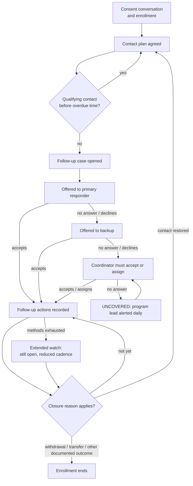
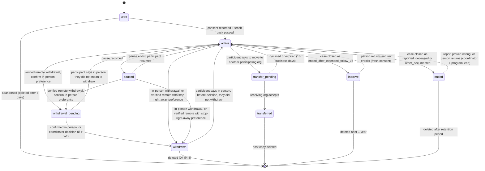
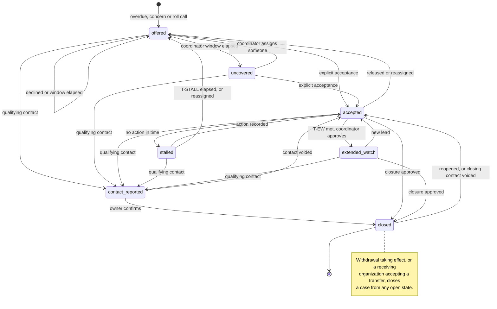

# 3. End-to-end workflow and state transitions

Status: **proposal**. This is the behavioral specification the MVP would be built and tested
against. Timers and intervals are *(provisional)* pilot defaults, configurable per host.

## 3.1 Overview



## 3.2 Provisional parameters

All durations in **business hours/days** run only during the host's staffed hours (assumed
Monday–Friday, 08:00–17:00 America/New_York, minus host holidays). Calendar days are used only for
contact intervals and grace periods, which participants understand in ordinary days.

| ID | Parameter | Pilot default |
|---|---|---|
| T-INT | Contact interval options | 7, 14, 30 calendar days |
| T-GRACE | Grace after the interval | 2 days (7-day plan), 3 days (14-day), 5 days (30-day) |
| T-RETURN | Window after a pause ends | min(interval, 7 days) + grace |
| T-P1 | Primary responder acceptance window | 3 business hours |
| T-P2 | Backup acceptance window | 3 business hours |
| T-P3 | Coordinator acceptance window | 2 business hours, then **uncovered** (so an owner within one business day) |
| T-ACT | First follow-up action after acceptance | 1 business day |
| T-UPD | Maximum gap between actions on an open case | 3 business days |
| T-STALL | Stalled case without action before it is reassigned to the backup | 1 business day |
| T-CONF | Confirming a reported contact on an open case | 1 business day |
| T-EW | Minimum before extended watch | 10 business days and every consented method tried or documented as impossible |
| T-EWR | Extended-watch review cadence | Every 10 business days |
| T-EWMAX | Extended watch before program-lead review of whether to continue | 90 calendar days |
| T-INP | Remote-only contact before an in-person prompt | 60 calendar days (prompt, not a case) |
| T-PAUSE | Maximum pause | 90 days if agreed in person; 14 days if requested remotely; renewable |
| T-WD | Remote-withdrawal confirmation window | 30 calendar days |
| T-BACK | Maximum backdating of a contact without coordinator approval | 72 hours |
| CAP-R | Open cases per responder | 6 |

## 3.3 Step 1 — Enrollment

**Preconditions** (system-enforced where possible):

* Host enrollment is not paused ([08 §8.5](08-pilot-operations.md#85-criteria-for-pausing-enrollment)).
  If it is, the enrollment screen says so and offers a script; no waiting-list data is stored.
* The person says they are 18 or older. No ID is requested.
* The person already has, or expects, some contact with the host; otherwise Heartbeat has nothing
  to record and would create false alarms.
* The conversation happens in private, without a companion present unless the participant asks for
  one, and not while the person is in acute crisis or waiting for a service they might think depends
  on it.

**Consent conversation (draft, for plain-language and legal review).** The enrollment worker covers,
in the participant's language, at about a 6th-grade reading level:

1. *What it is.* "If you sign up and we don't see or hear from you for about [interval], a named
   person here will try to reach you, in the ways you pick."
2. *What it isn't.* "It is not emergency help. We work [days and hours]. We can't promise to find
   you, and it doesn't keep you safe. If we can't operate — for example after a disaster — follow-up
   may stop until we can. In an emergency, call 911." (Wording to be checked against the host's
   emergency policy.)
3. *Your choice.* "You don't have to. Nothing you get here changes if you say no or stop later. It
   has nothing to do with church or religion."
4. *What we keep.* "The name you want us to use, other names if you want, the dates we saw or heard
   from you, the plan you pick, and what we did to reach you. We don't keep where you go, immigration
   information, ID numbers or health records."
5. *Who sees it.* "Only staff here who need it. Every look is recorded and you can ask to see who
   looked. We will not tell anyone who asks whether you're signed up. There is no way for police or
   immigration to get into this system, and we don't share with them. But a court can sometimes order
   records, and then we may have to hand them over — that's one reason we keep so little." (Final
   wording from counsel.) **[legal review]**
6. *Legal duties.* If counsel confirms a reporting duty applies (for example, North Carolina's duty
   to report a disabled adult who needs protective services), say so plainly. **[legal review]**
7. *Your controls.* The plan, the people we may ask, pausing, stopping, seeing your record.
8. *Teach-back.* The participant explains in their own words: what happens if they don't come by;
   whether this is emergency help; how to stop. Enrollment proceeds only if they can.

**Records created:** a participant record ([04](04-data-retention-audit.md)), a consent record with
the version of the script used and each choice made, the contact plan, and a participant code.
The participant leaves with a small card — only if they want one — showing the code, the host's
phone number and hours, and how to stop. The card does not show their name or the word "homeless".

**Verification answer.** The participant chooses a short word or number they will remember (not a
birthday or anything others know). It is stored hashed and used when staff do not know them by sight
or voice, and for relays.

**Primary responder.** The participant may ask for a staff member they trust; the coordinator
assigns a primary and a backup.

## 3.4 Step 2 — Contact plan

The plan holds the participant's choices from [02 §2.4](02-roles-and-permissions.md#24-participant-control):
interval, which contact kinds qualify, follow-up permissions, safe ways to reach them (phone number
and whether calling, texting or voicemail is safe; times to avoid), a short "where I'm usually
found" note in their own words, people who may be asked and what may be said, staff exclusions and
disaster priority.

Plans are versioned. Each change records who made it, whether the participant was **in person and
in private** or **remote**, and which fields changed. See §3.10 for rules on remote changes.

The disaster-priority choice is explained as "we'll try to reach you sooner after a disaster, when
we can" — never as rescue.

## 3.5 Step 3 — Recording contact

Every contact has a **kind** and an **identity confidence**. Neither may be left blank.

| Kind | Meaning |
|---|---|
| `in_person` | An authorized person saw and spoke with the participant face to face. |
| `phone_with_staff` | A live conversation between the participant and an authorized person. |
| `relay` | Staff at a participating partner organization had firsthand contact and relayed it ([07 §7.2](07-disaster-continuity.md#72-cross-organization-continuity)). |
| `self_check_in` | Participant-initiated without a live conversation: a voicemail, or a message left with someone. Later phases may add text-message check-ins. |
| `secondhand` | Someone else reports having seen or heard from the participant. |

| Identity confidence | Meaning |
|---|---|
| `known` | The recorder knows the participant personally (by sight, or by voice on the phone). |
| `verified` | The participant gave the correct verification answer. |
| `code_only` | The participant gave their code but not the verification answer. |
| `stated` | The person said who they were; nothing else confirmed it. |
| `reported` | Secondhand; the participant was not present. |

**What resets the clock (qualifying contact), by default:**

| | `known` | `verified` | `code_only` / `stated` | `reported` |
|---|---|---|---|---|
| `in_person` | ✓ | ✓ | — (recorded, flagged for confirmation) | n/a |
| `phone_with_staff` | ✓ | ✓ | — | n/a |
| `relay` | n/a | ✓ if the plan allows relays | — | n/a |
| `self_check_in` | — unless the plan allows it | — unless the plan allows it | — | n/a |
| `secondhand` | n/a | n/a | n/a | — never |

Non-qualifying contacts are still recorded: they appear to the responder as **leads** with their
kind and confidence. If the plan lets remote contact qualify and there has been no in-person contact
for T-INP, the next responder or coordinator to open the record sees a low-priority prompt to seek
private, in-person contact. That prompt never opens a case.

**Recording rules:**

* Each contact stores `occurred_at` and `recorded_at`. Backdating beyond T-BACK needs coordinator
  approval, so late paper forms after an outage can still be entered ([07](07-disaster-continuity.md)).
* There is no location field. Notes are allowed only on `self_check_in` and `secondhand` contacts
  (≤ 200 characters, with an on-screen reminder not to record where the person was); a relay may
  carry the participant's own message ([07 §7.2](07-disaster-continuity.md#72-cross-organization-continuity)).
* A contact recorded against the wrong person is **voided** with a reason, never deleted. Voiding
  the contact that closed a case reopens it.
* Recording takes under 30 seconds for a contact recorder: search, pick, choose kind and confidence,
  save. The picker shows the participant code alongside the name to reduce mix-ups.

## 3.6 Step 4 — Overdue detection

For an `active` participant (not paused):

```
due_at     = occurred_at(last qualifying contact, or enrollment, or pause end) + interval
overdue_at = due_at + grace          (after a pause: pause_end + T-RETURN)
```

If `overdue_at` falls outside staffed hours, the case opens at the start of the next business day.
The detector runs at the start of each business day and hourly during staffed hours. It is
idempotent: at most one open case per participant. After every run it records its completion, and
every business morning it sends the coordinator a digest **even when nothing is overdue** ("0 new
cases; detector last ran 08:00"). A missing digest is itself the alarm
([06 §6.3](06-failure-modes-and-abuse.md#63-system-and-operational-failures)).

## 3.7 Step 5 — Offer, acceptance and escalation

1. The case is **offered** to the primary responder (skipped if unavailable, conflicted, excluded by
   the participant, or at CAP-R).
2. The responder **accepts** or **declines with a reason** (on leave, conflict, capacity). Opening a
   notification is not acceptance; acceptance is a deliberate action with the words "I am
   responsible for this follow-up."
3. If not accepted within T-P1, the case is offered to the backup; after T-P2 to the coordinator on
   duty; after T-P3 it becomes **uncovered**: highlighted on every staff dashboard, sent to the
   program lead, and repeated each business morning until someone accepts.
4. After acceptance, if no action is recorded within T-ACT, or no further action within T-UPD, the
   case is marked **stalled** and the coordinator is told. If there is still no action after
   T-STALL, it is released from that responder and offered to the backup (or the coordinator), and
   the program lead is told.
5. A responder may **release** a case with a reason; it re-enters the offer chain at the backup.
6. Staff notifications carry no participant details ("You have a Heartbeat follow-up task"); the
   details are behind sign-in. Delivery success and failure are recorded.

## 3.8 Step 6 — Follow-up

The responder works through the methods the participant consented to, in an order the responder
judges sensible (usually least intrusive first). Each **follow-up action** records:

| Field | Values |
|---|---|
| Action | `checked_records`, `asked_host_staff`, `called`, `texted`, `left_voicemail`, `visited_usual_place`, `asked_named_person`, `asked_partner_org`, `other` |
| Source of any information | `participant`, `host_staff`, `partner_staff`, `named_person`, `other_person`, `none` |
| Result | `no_information`, `lead` (information that may help), `contact_restored` |
| Certainty | `low`, `medium`, `high` — how much the responder trusts what they learned |
| Note | ≤ 500 characters; prompts warn against recording location, health, immigration or third-party details |

The system shows only the methods the participant allowed. A responder who believes another method
is warranted records why and asks the coordinator; the system does not expand permissions.

If at any point the responder believes someone is in immediate danger, they follow the host's
emergency procedures **outside Heartbeat**. Heartbeat records only that a contact occurred, or a
follow-up action with action `other` and a neutral note; it has no emergency, police or referral
action types. Whether and how such events may be documented is a [legal-review](legal-review.md) item.

## 3.9 Step 7 — Closure

A case closes only for one of these reasons:

| Reason | Requires | Who |
|---|---|---|
| `contact_restored` | A linked qualifying contact (§3.5) after the case opened | Assigned responder or coordinator |
| `contact_restored_self_report` | A linked `self_check_in` the responder judges credible; always included in the coordinator's weekly closure review | Assigned responder or coordinator |
| `recording_gap` | A qualifying contact that occurred **before the case opened** but was entered afterwards | Assigned responder or coordinator |
| `withdrawn` | A withdrawal that takes effect per §3.10: in person, verified remote with "stop right away", or the coordinator's decision ending a pending withdrawal | The person recording it (closure is part of recording it) |
| `transferred` | A transfer accepted by the receiving organization ([07 §7.3](07-disaster-continuity.md#73-transfer-of-responsibility); not built in the pilot) | Receiving organization's coordinator; acceptance closes the sending host's case |
| `reported_deceased` | Source category (official notification; next of kin with official confirmation; host staff personally confirmed) and approval by the program lead with a second reviewer | Program lead + second reviewer |
| `ended_after_extended_follow_up` | Extended watch reached T-EWMAX and the program lead decided not to continue; the record states that **this is not a determination that the person has died or is well** | Program lead |
| `other_documented` | Free-text reason (≤ 500 chars) and program-lead approval | Program lead |

When a qualifying contact is recorded on an open case, the case moves to `contact_reported` and the
owner is told at once so they stop searching; the owner confirms the closure within T-CONF (to catch
mistaken identity), after which the coordinator is told. **The system never closes a case by
itself, and never because time has passed.**

A closed case may be reopened by the coordinator within 30 days if the closure was wrong.

## 3.10 Enrollment states, pauses, plan changes and withdrawal



**Pause.** For travel, a hospital stay, or wanting privacy for a while. A pause always has an end
date (≤ T-PAUSE). The clock stops; contacts can still be recorded. When the pause ends, the
participant has T-RETURN to make contact before a case opens. An open case can be paused only if
contact has been restored (the participant asks for the pause during that contact). A remote pause
cannot be extended remotely, and a new remote pause needs a qualifying contact since the last pause
ended, so a string of phone calls cannot keep someone paused indefinitely.

**Remote changes.** A change made by phone, relay or message rather than in person and in private
is labelled *remote*. These are **safety-reducing**: withdrawal, pause, longer interval, fewer
follow-up permissions, removing a named person, changing the phone number. Made remotely, they:

* are applied **only if the caller's identity is `known` or `verified`**; otherwise they are
  recorded as a lead, not applied, and the coordinator is told;
* then take effect at once, because continuing to contact someone who asked you to stop can itself
  put them at risk;
* are flagged on the plan and on any case opened within 30 days of the change ("plan changed
  remotely 3 days before contact stopped"); the next in-person contact prompts the coordinator to
  confirm the change privately with the participant.

**Withdrawal.** Withdrawal is never refused and never questioned beyond one private confirmation.

* *In person*, or *verified remote with the "stop right away" preference*: effective immediately;
  any open case closes as `withdrawn`. The participant chooses deletion (default; within 30 days,
  [04 §4.4](04-data-retention-audit.md#44-retention)) or keeping the record 90 days so they can
  rejoin.
* *Verified remote with the default "confirm in person" preference*: the participant becomes
  `withdrawal_pending`. Outreach to them, to named people and to partners stops at once and the
  clock stops. Any open case passes to the coordinator, limited to **passive** steps (checking
  records, asking host staff). Any in-person contact prompts the coordinator to confirm privately.
  At T-WD the coordinator **records a decision**: the withdrawal takes effect (the default), or —
  only for a specific documented concern such as a concern report or other recent remote changes —
  one extension of up to 30 days, after which it takes effect. If no decision is recorded within one
  business day of T-WD, the program lead is told each morning until it is. Silence alone never
  finalizes it.
* A withdrawn participant who says in person, before deletion, that they did not withdraw is
  reinstated by the coordinator, and the incident is reviewed.

## 3.11 Follow-up case states



Complete transition table (the implementation and its tests follow this table, not the diagram):

| From | Event | To | Owner afterwards |
|---|---|---|---|
| — | Overdue detected; coordinator opens a concern or roll-call case | `offered` | Offeree: primary, or next eligible |
| `offered` | Declined, or T-P1/T-P2 elapsed | `offered` | Next in chain |
| `offered` | T-P3 elapsed at the coordinator | `uncovered` | None — alarm |
| `uncovered` | Coordinator or program lead assigns a named person | `offered` | That person (offeree) |
| `offered`, `uncovered` | Explicit acceptance | `accepted` | Acceptor |
| `accepted` | T-ACT or T-UPD elapsed without an action | `stalled` | Same owner |
| `stalled` | Action recorded | `accepted` | Same owner |
| `stalled` | T-STALL elapsed, or coordinator reassigns | `offered` | Backup (or coordinator if the owner was the backup), or named person |
| `accepted` | Owner releases with a reason, or coordinator reassigns | `offered` | Next in chain, or named person |
| `accepted` | T-EW met and coordinator approves | `extended_watch` | Coordinator or a designated responder |
| `extended_watch` | New lead worth active follow-up | `accepted` | Same owner |
| any open state | Qualifying contact recorded | `contact_reported` | Existing owner; if none, the coordinator on duty |
| `contact_reported` | Owner confirms the right person | `closed` (`contact_restored` or `recording_gap`) | — |
| `contact_reported` | Contact voided (wrong person) | `accepted` | Same owner |
| `accepted`, `extended_watch` | Closure per §3.9 with its evidence and approvals (including `contact_restored_self_report`) | `closed` | — |
| any open state | Verified remote withdrawal, confirm-in-person preference | `accepted`, flagged *withdrawal pending*, passive steps only | Coordinator |
| any open state | Withdrawal takes effect (§3.10) | `closed` (`withdrawn`) | — |
| any open state | Receiving organization accepts a transfer | `closed` (`transferred`) | — |
| `closed` | Coordinator reopens within 30 days, or the closing contact is voided | `accepted` | Last owner; if unavailable, `offered` to the next in chain |

Guards the implementation must enforce:

| Guard | Rule |
|---|---|
| Single owner | `accepted`, `stalled`, `extended_watch` and `contact_reported` always have exactly one owner; `offered` has one offeree; `uncovered` has none, which is why it alarms. |
| No timeout closures | No transition into `closed` is triggered by a timer. |
| Neglect escalates | Stalled cases are reassigned after T-STALL with the program lead told. Extended-watch reviews and `contact_reported` confirmations more than one business day overdue go to the program lead every morning until done. |
| Closure evidence | `contact_restored` and `recording_gap` require a linked, non-voided contact meeting §3.9. |
| Approvals | §3.9 approvals are enforced in the database; the proposer of `reported_deceased` cannot be its second reviewer. |
| Capacity | Offers skip responders at CAP-R; the coordinator is never skipped. |
| Withdrawal and transfer | Recording an effective withdrawal, or a receiving organization's acceptance of a transfer, closes any open case with that reason, attributed to the person who recorded it. |
| Audit | Every transition writes an audit event with actor (or "system"), from-state, to-state and reason. |

## 3.12 Concerns raised by other people

Someone may call or visit to say they are worried about a person. Staff **neither confirm nor deny**
that the person is a participant ("I can't share whether anyone is part of our programs, but I can
take a message"). If the person is a participant, a coordinator records a `concern` on their record
with only a source category (family, friend, other organization, other) and, if the caller wants a
reply and offers it, a callback number visible only to the coordinator and deleted after 30 days.

* If the participant has an open case, the concern is attached as a lead.
* If not, and the concern suggests they may be out of contact, the coordinator may open a case early
  **only if** the participant's follow-up permissions cover the steps it would involve.
* If the participant asked to be told when someone asks about them, the next contact prompts staff
  to tell them privately.
* Nothing about the participant is ever disclosed to the person who raised the concern unless the
  participant has authorized it, and then only what they authorized.
