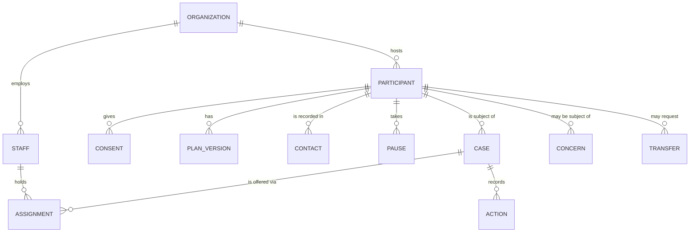

# 4. Minimal data model, retention and access audit

Status: **implemented** (`src/db/schema.ts`, `src/domain/retention.ts`). Retention periods are
*(provisional)* and need host and legal confirmation.

## 4.1 Rules for every field

A field belongs in Heartbeat only if a responder, coordinator or the participant needs it to notice
an absence or follow up on it, or if accountability requires it. Each field below names that need.

**Never collected** (no field, no free-text prompt, and training to keep it out of notes):
immigration or citizenship status; country of birth; Social Security, driver's licence, passport,
or any government ID number; date of birth (year only, optional); precise location, GPS, or any
location history; where a person was found; diagnoses, medications or treatment (beyond the
optional disaster-priority category); substance use; criminal history or justice involvement;
religion or religious participation; photographs (unless a later, separately reviewed decision adds
them); details about other people beyond a named contact's name, number and permitted message.

## 4.2 Entities

| Entity | Fields | Why |
|---|---|---|
| **Organization** | id, name, timezone, staffed hours and holidays, enrollment paused (bool, reason), escalation hold (bool), relay partner (bool) | Business-hour timers; enrollment and disaster controls |
| **Staff** | id, organization, display name, work email, work phone (optional, for notifications), roles, availability (in/out with dates), training completed (date per module), active | Accountability, offers, notifications, training gates |
| **Conflict** | staff, participant, source (`staff_declared` / `participant_requested`), created | Blocks a staff member from a record |
| **Participant** | id (random UUID), host organization, participant code, preferred name, other names (each marked whether recorders may see it), lookup (`name` / `code_only`), birth year (optional), languages, accessibility note (≤ 200 chars), verification answer (salted hash), primary and backup responder, enrollment state, created | Identify the right person and reach them |
| **Consent** | participant, script version, each choice (enroll; follow-up permissions; relays; named people; continuity sharing), witnessed by, method (`in_person` / `remote`), teach-back passed, date | Evidence of informed, specific consent |
| **Plan version** | participant, version, interval, grace, qualifying kinds, follow-up permissions, phone number with safe-use flags (call / text / voicemail / times to avoid), "usually found" note (≤ 200 chars, participant's words), named people (name, phone, permitted message), tell-me-if-asked, remote-withdrawal preference, disaster priority and category, changed by, change channel (`in_person` / `remote`), confirmed in person (date), effective from | The participant's choices; remote-change flags |
| **Pause** | participant, start, end, requested via, created by | Stops the clock with an end date |
| **Contact** | participant, kind, identity confidence, occurred_at, recorded_at, recorded by (staff, organization), qualifying (computed at save), note (≤ 200 chars; only for `self_check_in`, `secondhand`), relay message (≤ 140 chars; relays only), voided (by, at, reason) | The clock and leads. **No location.** |
| **Case** | participant, trigger (`overdue` / `concern` / `roll_call`), opened_at, state, owner, priority, closure reason, closure contact (copied kind and confidence), closed by, approved by, second reviewer, closed_at | The follow-up record |
| **Assignment** | case, staff, role in chain (`primary` / `backup` / `coordinator` / `reassigned`), offered_at, accepted_at, declined (reason), expired_at, released (reason) | Proves who was responsible when |
| **Action** | case, staff, at, action, source, result, certainty, note (≤ 500 chars) | What was done and learned |
| **Concern** | participant, received_at, source category, callback number (coordinator-only; 30 days), linked case, participant told (date) | Concerns raised by others |
| **Transfer** | participant, from org, to org, consent (in-person), package sent, accepted by, accepted_at, expired | Verified handover |
| **Notification** | staff, case, channel, sent_at, delivered / failed, error | Shows whether alerts actually reached people |
| **Audit event** | see §4.6 | Accountability |

Participant codes are 8 characters from an unambiguous alphabet (no 0/O, 1/I/L) plus a check
character (a weighted sum mod 31, which catches every single-character typo and adjacent swap), e.g. `HB-K7QP-3MXD-R`, randomly generated and unique across all organizations. They
carry no meaning.

## 4.3 Storage and security baseline

* One relational database with constraints that enforce the state guards in
  [03 §3.11](03-workflow-and-states.md#311-follow-up-case-states) (single owner, closure evidence,
  approvals), not just application code.
* Hosted off-site and outside western North Carolina, so a regional disaster does not take down the
  system and the host at once ([07](07-disaster-continuity.md)). TLS everywhere; encryption at rest
  for the database, backups and exports.
* No participant data in URLs (opaque IDs only), application logs (method, route, status only),
  analytics (none), search engines (`noindex`), email or text notifications (generic text only), or
  error reports.
* Separate credentials for the application, the retention job, and audit export; the application
  account cannot update or delete audit events.

## 4.4 Retention

| Data | Kept | Then |
|---|---|---|
| Draft enrollment (consent not completed) | 7 days | Deleted |
| Participant record and current plan | While `active`, `paused` or `withdrawal_pending` | See end-of-enrollment rows |
| Superseded plan versions | 90 days | Values deleted; the audit event keeps only which fields changed and the channel |
| Contacts | 90 days after `occurred_at`; the participant record keeps only the date, kind and confidence of the latest qualifying contact and the latest in-person contact | Deleted after monthly de-identified aggregates are computed |
| Voided contacts | 30 days after voiding | Deleted |
| Case action notes | 180 days after the case closes | Notes deleted; structured fields kept as a pseudonymous case record |
| Pseudonymous case records (timestamps, states, action types, results, closure reason) | Until 1 year after the pilot ends | Deleted; de-identified aggregates kept |
| Concern callback numbers | 30 days | Deleted |
| Withdrawn or transferred participant | 30 days after it takes effect (90 days if the participant chose "keep so I can rejoin") | Deleted, leaving a tombstone: random id, host, enrollment month, end month, end reason category |
| `inactive` participant (ended after extended follow-up) | 1 year, so the host recognizes the person if they return | Deleted, tombstone as above |
| `ended` participant (reported deceased, other documented outcome) | 180 days | Deleted, tombstone as above |
| Audit events | 2 years. After 90 days, search terms are dropped, and contact and relay events lose their participant id (so the audit trail cannot rebuild a contact history) | Deleted |
| Notification delivery records | 90 days | Deleted |
| Backups | 30-day rolling, encrypted | Expire; deletions are complete when the last backup containing the data expires |
| Paper contact forms (outages) | Until entered, target ≤ 3 business days | Shredded; shredding recorded |
| Printed continuity sheets | Until replaced | Shredded; shredding recorded |
| Everything, if the pilot ends without continuation | 60 days after participants are told | Deleted; de-identified evaluation data kept |

**Legal hold.** If counsel instructs that a specific record must be preserved, deletion is
suspended for that record only, with the instruction reference in the audit log.

**Why contacts are kept so briefly.** Even without a location field, a long list of dated contacts
at named organizations is a coarse movement history. Ninety days covers disputes ("I was there on
Tuesday") and evaluation, after which only the latest dates are needed for the clock. The same
limit applies to the audit trail: after 90 days a contact's audit event says only that a staff member
recorded a contact at a time, not for whom.

## 4.5 Deletion approach

Deletion is real deletion of rows, run nightly by the retention job and recorded as an audit event
("deleted N contacts older than 90 days"; "deleted participant record <random id>"). Audit events
refer to participants only by random id and never contain names, notes or plan values, so they can
outlive the record without keeping personal information. After deletion the random id resolves to
nothing except its tombstone.

The repository's original one-line description was "append-only logging of human presence and
absence". This design keeps **append-only** for the audit trail and for state transitions while a
record exists, but rejects append-only storage of personal information, because participants must be
able to leave and have their information deleted. A later phase could add per-participant
encryption keys ("crypto-shredding") so deletion also reaches backups immediately.

## 4.6 Access audit

**What is logged** (each with time, actor, actor's organization, target, participant random id and
outcome):

* Every view of participant detail, with the **basis** the system used: `assignment`,
  `recording`, `enrollment`, `coordinator`, or `reason` (with the typed reason).
* Every search, with its terms (dropped after 90 days) and number of results.
* Every create, change, void, state transition, approval, print and export.
* Every relay attempt, success or failure, and every verification lockout.
* Sign-ins, failed sign-ins, role and conflict changes, break-glass access, and audit-log views.
* Every retention-job run and every notification's delivery outcome.

**Integrity.** A trigger rejects updates and deletes of audit events (only redaction of the
participant link and search terms is allowed, and purging after two years by the retention job);
in production the application's database role also lacks those privileges. Events are hash-chained.
Each night the day's event hashes and chain head — no contents — are exported to separate storage
that the application cannot overwrite, and operators can verify the whole chain.

**Review.** Monthly, the program lead works through a generated exception report and records
sign-off (itself logged):

* `reason`-basis views and who made them;
* views and searches outside staffed hours;
* any staff member with unusually many views or searches;
* prints, exports and continuity-sheet prints;
* break-glass events (also notified immediately);
* failed relay verifications and lockouts;
* searches for names that returned no participant (possible fishing).

**For participants.** On request, staff print a plain summary of everything held about the
participant and an access summary: which role and organization viewed or changed the record and
when. Individual staff names are given on request through the program lead.
